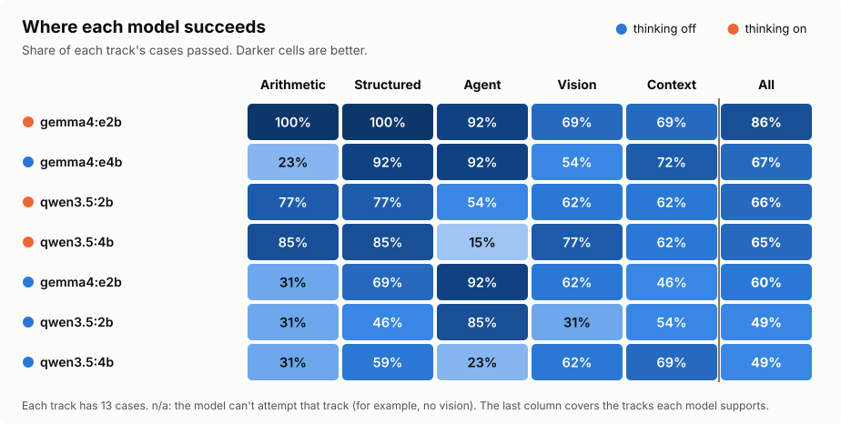
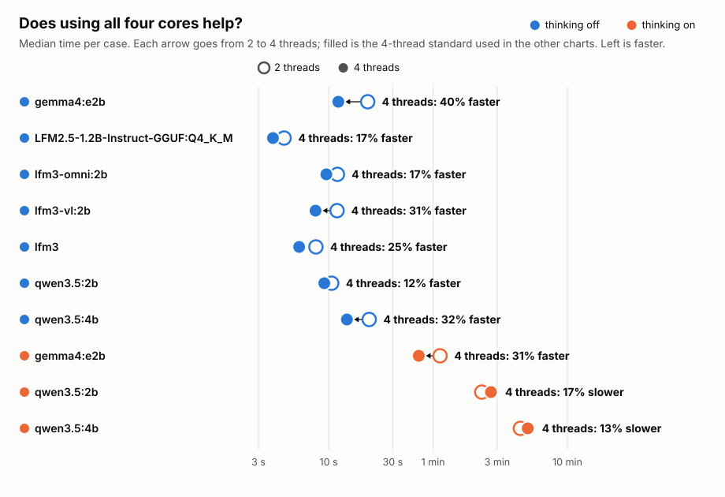
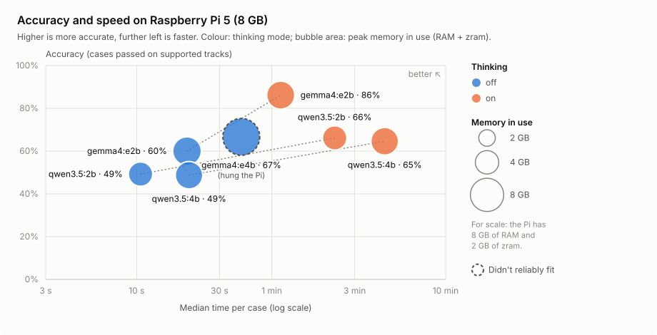

# Light Eval

**Which local LLM should you run on a Raspberry Pi 5 with 8 GB?** Light Eval answers that with a fixed, versioned set of tasks, run on the device itself. Every answer is checked deterministically, with no LLM judge, while the runner records speed, memory and temperature.

[](https://github.com/monaj07/light-eval/actions/workflows/tests.yml)
[](LICENSE)


**[Results](#results)** · **[Failure analysis](docs/ANALYSIS.md)** · **[What it measures](#what-it-measures)** · **[Quick start](#quick-start)** · **[Methodology](docs/METHODOLOGY.md)** · **[Changelog](CHANGELOG.md)**

## Why Light Eval

- 🎯 **No LLM judge.** Answers are typed JSON values compared exactly. Tool calls are checked call by call, including arguments, order and final state.
- 🧱 **65 cases across 5 tracks**, each with controls and harder challenges. Every case was solved blind by a reviewer who saw only the prompts and images.
- 🌡️ **Hardware-aware.** For every case it records time, tokens per second, RAM, zram swap, CPU temperature and throttling flags.
- 🧠 **Thinking off and on as separate runs**, each with its own token budget, and models compared only within one mode.
- ⚖️ **Fair scheduling.** Model order is balanced across cycles, every model starts from the same temperature, and model digests and source hashes are recorded.
- 📦 **Python standard library only.** It talks to your local [Ollama](https://ollama.com) server and needs no packages or API keys.

## Results

**Bottom line:** on an 8 GB Raspberry Pi 5, run **`gemma4:e2b`**. With thinking on it is the most accurate model tested (86% of cases) and the fastest of the accurate options, at a median of 47 seconds per case in under 6 GB of memory. With thinking off it scores 60% at about 12 seconds per case. All results use the Pi's 4 CPU cores, Ollama's usual setting. With 2 threads, `gemma4:e2b` is 31–40% slower at the same accuracy. CPU temperature peaks at about 78 °C with the official Active Cooler, without throttling.

<!-- results:start -->

_Generated by `python3 tools/publish.py build` from the runs in [`docs/results/`](docs/results/). Suite 1.7.0: 65 cases (29 control, 36 challenge)._

### Raspberry Pi 5 (8 GB)

Setup: Raspberry Pi 5 8 GB; Raspberry Pi OS Lite 64-bit, headless; official Raspberry Pi Active Cooler; clear vented acrylic case with lid; official Raspberry Pi 27 W USB-C power supply; SanDisk Extreme 128 GB microSDXC UHS-I; Ollama systemd service with LLAMA_ARG_CACHE_RAM=0; 2 GB zram; room about 22 C (estimated)

<p><a href="docs/assets/hardware/raspberry-pi-hardware.jpg"></a> <a href="docs/assets/hardware/raspberry-pi-assembled.jpg"></a></p>

### At a glance

| Model | Thinking | Accuracy | Tracks | Time per case | Memory | Note |
|---|---|---:|---|---:|---|---|
| `gemma4:e2b` | on | **86%** | 5/5 | 46.9 s | ✅ 5.7 GB | 1 case hit the 10-minute limit |
| `qwen3.5:2b` | on | **71%** | 5/5 | 2.7 min | ✅ 4.4 GB | 9 cases hit the 10-minute limit |
| `gemma4:e4b` (2 threads only) | off | **67%** | 5/5 | 40.1 s | ❌ 9.9 GB≈ | hung the Pi in 1 of 4 passes |
| `qwen3.5:4b` | on | **66%** | 5/5 | 5.1 min | ✅ 5.6 GB | 11 cases hit the 10-minute limit |
| `gemma4:e2b` | off | **60%** | 5/5 | 11.8 s | ✅ 5.7 GB |  |
| `qwen3.5:2b` | off | **49%** | 5/5 | 9.3 s | ✅ 4.2 GB |  |
| `qwen3.5:4b` | off | **49%** | 5/5 | 13.7 s | ✅ 5.4 GB |  |

Accuracy is the share of cases passed on the tracks the model supports; Tracks shows how many of the 5 that is. A track a model can't attempt (no vision, for example) is not counted as 0%. Time is the median per case. Memory is the peak in use, RAM plus zram, against the Pi's 7.9 GB of usable RAM.

<picture>
  <source media="(max-width: 600px) and (prefers-color-scheme: dark)" srcset="docs/assets/thinking-raspberry-pi-5-8-gb-mobile-dark.svg">
  <source media="(max-width: 600px)" srcset="docs/assets/thinking-raspberry-pi-5-8-gb-mobile-light.svg">
  <source media="(prefers-color-scheme: dark)" srcset="docs/assets/thinking-raspberry-pi-5-8-gb-dark.svg">
  
</picture>

### Strengths and weaknesses by track

<picture>
  <source media="(max-width: 600px) and (prefers-color-scheme: dark)" srcset="docs/assets/tracks-raspberry-pi-5-8-gb-mobile-dark.svg">
  <source media="(max-width: 600px)" srcset="docs/assets/tracks-raspberry-pi-5-8-gb-mobile-light.svg">
  <source media="(prefers-color-scheme: dark)" srcset="docs/assets/tracks-raspberry-pi-5-8-gb-dark.svg">
  
</picture>

### 2 vs 4 CPU threads

<picture>
  <source media="(max-width: 600px) and (prefers-color-scheme: dark)" srcset="docs/assets/threads-raspberry-pi-5-8-gb-mobile-dark.svg">
  <source media="(max-width: 600px)" srcset="docs/assets/threads-raspberry-pi-5-8-gb-mobile-light.svg">
  <source media="(prefers-color-scheme: dark)" srcset="docs/assets/threads-raspberry-pi-5-8-gb-dark.svg">
  
</picture>

The main results use 4 threads, all of the Pi's cores. Compared with 2 threads, prompt processing is faster, but generation can be slower; details are in the full results below.

### Full results

<details>
<summary>All tables: per-track scores, speed, where the time goes, memory, temperature, threads, and the accuracy, speed and memory chart</summary>

#### Accuracy, speed and memory

<picture>
  <source media="(prefers-color-scheme: dark)" srcset="docs/assets/score-vs-time-raspberry-pi-5-8-gb-dark.svg">
  
</picture>

Note: Official thinking-off run, rounds 1–3 of 4. Round 4 is left out: during it, gemma4:e4b exhausted the Pi's memory (RAM and zram full) and the Pi hung and rebooted after 49 of its 65 cases.

#### Thinking off: scores by track

| Model | Accuracy<br>(all) | Accuracy<br>(text) | Challenge | Arithmetic | Structured | Agent | Vision | Context | Time per<br>case | Timed<br>out | Peak memory<br>(lowest free) | CPU °C<br>mean / peak |
|---|---:|---:|---:|---:|---:|---:|---:|---:|---:|---:|---|---|
| `gemma4:e4b` (2 threads only) | **67%** | 70% | 19.3 | 3 | 12 | 12 | 7 | 9.3 | 40.1 s | 0 | ❌ 9.9 GB≈ (10 MB free) | 62 / 67 |
| `gemma4:e2b` | **60%** | 60% | 14 | 4 | 9 | 12 | 8 | 6 | 11.8 s | 0 | ✅ 5.7 GB (2.2 GB free) | 71 / 77 |
| `qwen3.5:2b` | **49%** | 54% | 15 | 4 | 6 | 11 | 4 | 7 | 9.3 s | 0 | ✅ 4.2 GB (3.7 GB free) | 68 / 75 |
| `qwen3.5:4b` | **49%** | 46% | 14 | 4 | 7.7 | 3 | 8 | 9 | 13.7 s | 0 | ✅ 5.4 GB (2.4 GB free) | 72 / 78 |

Scores are averaged over 3 passes. Challenge counts are out of 36 cases and each track out of 13.

#### Thinking on: scores by track

| Model | Accuracy<br>(all) | Accuracy<br>(text) | Challenge | Arithmetic | Structured | Agent | Vision | Context | Time per<br>case | Timed<br>out | Peak memory<br>(lowest free) | CPU °C<br>mean / peak |
|---|---:|---:|---:|---:|---:|---:|---:|---:|---:|---:|---|---|
| `gemma4:e2b` | **86%** | 90% | 28 | 13 | 13 | 12 | 9 | 9 | 46.9 s | 1 | ✅ 5.7 GB (2.2 GB free) | 71 / 77 |
| `qwen3.5:2b` | **71%** | 71% | 23 | 11 | 9 | 9 | 9 | 8 | 2.7 min | 9 | ✅ 4.4 GB (3.6 GB free) | 65 / 72 |
| `qwen3.5:4b` | **66%** | 63% | 22 | 13 | 10 | 1 | 10 | 9 | 5.1 min | 11 | ✅ 5.6 GB (2.3 GB free) | 66 / 77 |

Challenge counts are out of 36 cases and each track out of 13.

Peak memory in use is system-wide (Raspberry Pi OS and Ollama included): RAM in use plus pages swapped to zram, at the warm phase's peak. The Pi has 7.9 GB of usable RAM and 2 GB of zram. ≈ marks runs recorded before zram's own RAM use was measured: they add the separate peaks of RAM and swap, and count zram's compressed pages twice, so they overstate memory in use when zram is busy. ✅ more than 0.5 GB stayed free and swap stayed under 1 GB; ⚠️ less free or more swap; ❌ ran out of memory or hung the Pi.

#### Speed (thinking off)

| Model | First load from storage | Prompt processing | Generation (in cases) | Generation (sustained) | Sustained drift |
|---|---:|---:|---:|---:|---:|
| `qwen3.5:2b` | 34 s | 37.3 tokens/s | 5.5 tokens/s | 5.3 tokens/s | -2.5% |
| `gemma4:e2b` | 55 s | 36.8 tokens/s | 14.3 tokens/s | 8.4 tokens/s | -2.6% |
| `qwen3.5:4b` | 42 s | 22.3 tokens/s | 3.8 tokens/s | 3.5 tokens/s | -3.0% |
| `gemma4:e4b (2 threads only)` | 88 s | 10.7 tokens/s | 6.7 tokens/s | 4.5 tokens/s | +0.8% |

Prompt processing is how fast a model reads its input, and it is limited by computation; generation is how fast it writes, and it is limited mostly by memory bandwidth. These runs use all 4 of the Pi's cores (`--threads 4`). "In cases" is generation during the 65 cases, whose answers are short JSON; "sustained" is 90 seconds of continuous free prose. The Gemma builds include a small draft model for speculative decoding, which likely explains why they generate faster on short, predictable JSON than on prose.

#### Where the time per case goes (thinking off)

| Model | Median time per case | Reading the prompt | Writing the answer | Share spent reading | Answer length (median) |
|---|---:|---:|---:|---:|---:|
| `qwen3.5:2b` | 9.3 s | 7.9 s | 2.8 s | 71% | 15 tokens |
| `gemma4:e2b` | 11.8 s | 10.8 s | 1.1 s | 90% | 14 tokens |
| `qwen3.5:4b` | 13.7 s | 11.2 s | 3.6 s | 66% | 13 tokens |
| `gemma4:e4b (2 threads only)` | 40.1 s | 37.4 s | 2.0 s | 93% | 13 tokens |

Answers are short, so most of each case is spent reading the prompt, especially for vision and long-context cases. That is why a model can generate quickly and still take the longest per case. Times are medians over cases, from Ollama's own prompt and generation durations, so reading and writing don't add up exactly to the median time per case.

#### 2 → 4 threads: speed

Prompt processing and generation are in tokens/s.

| Model | Thinking | Time per case | Prompt processing | Generation | Generation (sustained) |
|---|---|---:|---:|---:|---:|
| `qwen3.5:2b` | off | 10.5 → 9.3 s 🟢 -12% | 40.3 → 37.3 🔴 -8% | 6.3 → 5.5 🔴 -12% | 6.1 → 5.3 🔴 -14% |
| `gemma4:e2b` | off | 19.5 → 11.8 s 🟢 -40% | 22.0 → 36.8 🟢 +67% | 12.5 → 14.3 🟢 +15% | 7.5 → 8.4 🟢 +12% |
| `qwen3.5:4b` | off | 20.0 → 13.7 s 🟢 -32% | 13.4 → 22.3 🟢 +66% | 4.2 → 3.8 🔴 -11% | 4.0 → 3.5 🔴 -12% |
| `gemma4:e2b` | on | 1.1 min → 46.9 s 🟢 -31% | 22.0 → 36.9 🟢 +67% | 11.3 → 12.8 🟢 +13% | — |
| `qwen3.5:2b` | on | 2.3 → 2.7 min 🔴 +17% | 39.6 → 35.7 🔴 -10% | 5.8 → 5.1 🔴 -12% | — |
| `qwen3.5:4b` | on | 4.5 → 5.1 min 🔴 +13% | 13.4 → 21.4 🟢 +60% | 3.8 → 3.3 🔴 -14% | — |

#### 2 → 4 threads: outcomes

| Model | Thinking | Accuracy | Timed out | Peak CPU |
|---|---|---:|---:|---:|
| `qwen3.5:2b` | off | 49 → 49% | 0 → 0 | 69 → 75 °C 🔴 |
| `gemma4:e2b` | off | 60 → 60% | 0 → 0 | 65 → 77 °C 🔴 |
| `qwen3.5:4b` | off | 49 → 49% | 0 → 0 | 68 → 78 °C 🔴 |
| `gemma4:e2b` | on | 86 → 86% | 1 → 1 | 68 → 77 °C 🔴 |
| `qwen3.5:2b` | on | 66 → 71% 🟢 | 11 → 9 🟢 | 69 → 72 °C 🔴 |
| `qwen3.5:4b` | on | 65 → 66% 🟢 | 13 → 11 🟢 | 69 → 77 °C 🔴 |

Each pair compares an official run at the main thread count with one at the other, for the same model and thinking mode; everything else is identical. Each cell reads from 2 threads to 4 ("19.5 → 11.8 s"), with the relative change where it helps: 🟢 marks an improvement (faster, more accurate, fewer timeouts, cooler) and 🔴 a change for the worse. Prompt processing is limited by computation, so more cores can speed it up. Generation is limited mostly by memory bandwidth, which the cores share, so more threads may not help it and can even slow it down. With thinking on, a change in speed also changes how many cases finish inside the 10-minute limit.

</details>

<!-- results:end -->

### Key findings

For what the models actually answered in each track, and why it was scored as it was, see the **[failure analysis](docs/ANALYSIS.md)**.

- **With thinking on, `gemma4:e2b` is the clear winner.** It passes 56 of 65 cases (86%), up from 39 (60%) with thinking off, at a median of 47 seconds per case, and runs out of time on only 1 case. `qwen3.5:2b` and `qwen3.5:4b` reach 71% and 66%, but they think for much longer: medians of 2.7 and 5.1 minutes, with 9 and 11 cases hitting the 10-minute limit before answering. `gemma4:e4b` wasn't run with thinking on, because it didn't reliably fit even with thinking off.
- **Thinking fixes reasoning, at a cost in time.** It turns nearly every arithmetic and structured-output failure into a pass: the thinking-off failures in the [failure analysis](docs/ANALYSIS.md) mostly pass with thinking on. The median time per case grows about 4× for `gemma4:e2b` (12 s to 47 s) and 17–22× for the Qwen models.
- **Bigger isn't better at tool use, and thinking doesn't help it.** With thinking off, `qwen3.5:4b` passes 3 of 13 agent cases against 11 for `qwen3.5:2b`, mostly by adding tool calls the task didn't ask for. With thinking on, the Qwen models do worse still (1 and 9), while `gemma4:e2b` stays at 12.
- **`gemma4:e4b` doesn't reliably fit in 8 GB.** It scores 67% with thinking off, more than any other model in that mode, but it filled the RAM and zram in every pass, and once the Pi ran out of memory and hung. So it was run only with thinking off and 2 threads, and is marked that way.

### Practical notes for running models on a Pi

- **Ollama's prompt cache can use up to 8 GiB.** By default each runner keeps earlier prompts in RAM, which swamps an 8 GB Pi. Set `LLAMA_ARG_CACHE_RAM=0` on the Ollama server (see [Quick start](#quick-start)).
- **On the Pi, reading the prompt takes longer than writing the answer.** With thinking off, answers are short, so 66–93% of each case is spent processing the prompt. `gemma4:e4b`, measured at 2 threads, writes at a reasonable 6.7 tokens/s but reads prompts at only 10.7 tokens/s, so it takes the longest per case (40 s) of the thinking-off runs. At 4 threads, `gemma4:e2b` reads at 37 tokens/s.
- **On the Pi, the time limit, not the token budget, is what stops thinking.** No case used up the 6,144-token budget. All 21 thinking-on timeouts reached the 10-minute limit while the model was still reasoning. Part of those 10 minutes goes to reading the prompt, and generation with thinking on runs at only 3.3–12.8 tokens/s.
- **More threads help Gemma and slow down Qwen's writing.** Compared with 2 threads, 4 threads speeds up `gemma4:e2b` at both reading and writing, cutting its time per case by 31–40%. Prompt processing is also about 66% faster for `qwen3.5:4b`, but generation is 11–14% *slower* for both Qwen models. So with thinking on, where long reasoning is mostly generation, the Qwen models get 13–17% slower overall. Scores are unchanged with thinking off. The results use 4 threads, all of the Pi's cores; the 2-thread comparison is under the results.
- **The Pi stays cool enough with the official Active Cooler.** At 4 threads, CPU temperature averaged 65–72 °C and peaked at 78 °C, below the roughly 80 °C at which the Pi 5 starts throttling. No case recorded a throttling flag. Sustained generation speed slipped by 2.5–3% over each 90-second phase, against under 2% at 2 threads, where the Pi ran about 8–12 °C cooler.
- **Repeat runs are close, but not identical.** Across three passes on the Pi, 74–82% of cases produced word-for-word the same output, and the pass or fail result differed between passes for only 2 of 260 model–case pairs. Scores are therefore averaged over the passes.

## What it measures

| Track | What a case looks like | Controls | Challenges |
|---|---|---:|---:|
| 🔢 **Arithmetic** | Multi-step word problems: percentages, time across midnight, compound interest, clock-hand angles | 6 | 7 |
| 🧾 **Structured output** | Extract, group, filter, sort and convert into exact JSON | 6 | 7 |
| 🛠️ **Agentic tools** | Native tool calls against a deterministic order-and-indicator simulator; tool use and the final answer are scored separately | 6 | 7 |
| 👁️ **Vision** | Counting among distractors, relative position, chart ranking, reading a receipt or a table and calculating | 6 | 7 |
| 📜 **Context** | Find facts in 8- to 96-record logs, with revisions, cross-references, filters and missing evidence | 5 | 8 |

Each run has three phases:
- **Cold:** the first request, including model load time.
- **Warm:** all cases on one model load.
- **Sustained:** at least 90 s of continuous generation, to see whether speed drops.

The [methodology](docs/METHODOLOGY.md) has the scoring rules, budgets and fairness details.

## Quick start

You need [Ollama](https://ollama.com) with the models pulled, and Python 3.10 or newer.

**1. Disable Ollama's prompt cache on the server.** Otherwise memory grows with every case.

```bash
# Raspberry Pi (systemd)
sudo systemctl edit ollama          # add under [Service]:  Environment="LLAMA_ARG_CACHE_RAM=0"
sudo systemctl restart ollama

# Mac app, for development: then quit and reopen Ollama
launchctl setenv LLAMA_ARG_CACHE_RAM 0
```

**2. Run the benchmark.** Make sure no model is loaded first: `ollama ps` should list nothing.

```bash
git clone https://github.com/monaj07/light-eval && cd light-eval
python3 light_eval.py run --models qwen3.5:2b --phases warm --out results/my-first-run
python3 light_eval.py run --models qwen3.5:2b --phases warm --thinking on --out results/my-thinking-run
```

The runner uses 4 CPU threads by default (`--threads`), all of a Pi 5's cores. The results include a 2-vs-4-thread comparison: 4 threads help the Gemma models but slow down the Qwen models' generation. On a Mac, add `--no-thermal-gate`. A Mac is handy for developing and checking cases quickly, but published results come from the Pi. For results you intend to publish, follow [docs/OFFICIAL_RUNS.md](docs/OFFICIAL_RUNS.md). It covers the schedule, the preflight checks, and `--setup "…"`, which records your cooling, power supply and storage in the manifest.

**3. Read the results.**

```bash
python3 light_eval.py report results/my-first-run
```

Each run folder holds:
- `manifest.json`: settings, model digests and source hashes.
- `cases.jsonl`: every case, with the model's output.
- `summary.json`
- `telemetry.jsonl`: one sample per second.

**4. Publish a run** (for maintainers). This copies the run into `docs/results/` and rebuilds the tables and charts above.

```bash
python3 tools/publish.py add results/my-first-run --name pi5-off-qwen3.5-2b
python3 tools/publish.py build
```

Compare models only within one suite version and one thinking mode. Mac and Pi results are only comparable when `ollama list` shows the same model IDs on both. On a Mac, the `-it-q4_K_M` Gemma tags match the Pi builds.

## Roadmap

- [x] Deterministic five-track suite with controls and challenges (suite 1.7.0)
- [x] Thinking off and on as separate runs
- [x] Bounded memory on 8 GB devices (`LLAMA_ARG_CACHE_RAM=0`)
- [x] Per-run temperature and throttling report
- [x] Thinking-on runs on the Pi
- [x] Official runs on a Pi in a fixed, documented setup ([protocol](docs/OFFICIAL_RUNS.md))
- [x] 4 threads instead of 2, with thinking off and on, to measure the effect on speed, temperature and accuracy ([protocol and outcome](docs/OFFICIAL_RUNS.md#thread-count))
- [ ] More Pi-sized models: the LFM family (LFM2.5 1.2B and 2.6B, `lfm3-vl`)
- [ ] Held-out cases that were never used to tune the protocol

## Contributing

Issues and pull requests are welcome. The tests use a mock Ollama server, so they need no models:

```bash
python3 -m unittest discover -s tests -v
```

Any change to cases, scoring or the run protocol bumps `VERSION` in `cases.py` and adds an entry to [CHANGELOG.md](CHANGELOG.md). A new case is accepted only after a reviewer who sees just the prompt (and image) answers it correctly, and prompts must never reveal answers; a test enforces that.

## Citation

If you use Light Eval, please cite it through the **Cite this repository** button on GitHub, which reads [CITATION.cff](CITATION.cff).

## License

[MIT](LICENSE)
