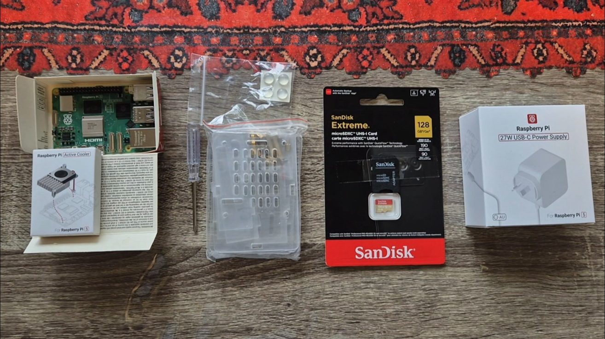

# Light Eval

**Which local LLM should you run on a Raspberry Pi 5 with 8 GB?** Light Eval answers that with a fixed, versioned set of tasks, run on the device itself. Every answer is checked deterministically, with no LLM judge, while the runner records speed, memory and temperature.

[](https://github.com/monaj07/light-eval/actions/workflows/tests.yml)
[](LICENSE)


**[Results](#results)** · **[Failure analysis](docs/ANALYSIS.md)** · **[What it measures](#what-it-measures)** · **[Quick start](#quick-start)** · **[Methodology](docs/METHODOLOGY.md)** · **[Changelog](CHANGELOG.md)**

## Why Light Eval

- 🎯 **No LLM judge.** Answers are typed JSON values compared exactly. Tool calls are checked call by call, including arguments, order and final state.
- 🧱 **65 cases across 5 tracks**, each with controls and harder challenges. Every case was solved blind by a reviewer who saw only the prompts and images.
- 🌡️ **Hardware-aware.** For every case it records time, tokens per second, RAM, zram swap, CPU temperature and throttling flags.
- 🧠 **Thinking off and on as separate runs**, each with its own token budget, and models compared only within one mode.
- ⚖️ **Fair scheduling.** Model order is balanced across cycles, every model starts from the same temperature, and model digests and source hashes are recorded.
- 📦 **Python standard library only.** It talks to your local [Ollama](https://ollama.com) server and needs no packages or API keys.

## Results

<!-- results:start -->

_Generated by `python3 tools/publish.py build` from the runs in [`docs/results/`](docs/results/). Suite 1.7.0: 65 cases (29 control, 36 challenge)._

### Raspberry Pi 5 (8 GB)

Setup: Raspberry Pi 5 8 GB; Raspberry Pi OS Lite 64-bit, headless; official Raspberry Pi Active Cooler; clear vented acrylic case with lid; official Raspberry Pi 27 W USB-C power supply; SanDisk Extreme 128 GB microSDXC UHS-I; Ollama systemd service with LLAMA_ARG_CACHE_RAM=0; 2 GB zram; room about 22 C (estimated)

<p><a href="docs/assets/hardware/raspberry-pi-hardware.jpg"></a> <a href="docs/assets/hardware/raspberry-pi-assembled.jpg"></a></p>

Note: Official thinking-off run, rounds 1–3 of 4. Round 4 is left out: during it, gemma4:e4b exhausted the Pi's memory (RAM and zram full) and the Pi hung and rebooted after 49 of its 65 cases.

<picture>
  <source media="(prefers-color-scheme: dark)" srcset="docs/assets/score-vs-time-raspberry-pi-5-8-gb-dark.svg">
  
</picture>

**Speed** (thinking off)

| Model | First load from storage | Prompt processing | Generation (in cases) | Generation (sustained) | Speed change during the sustained phase |
|---|---:|---:|---:|---:|---:|
| `qwen3.5:2b` | 33 s | 40.3 tokens/s | 6.3 tokens/s | 6.1 tokens/s | -1.8% |
| `gemma4:e2b` | 55 s | 22.0 tokens/s | 12.5 tokens/s | 7.5 tokens/s | +0.1% |
| `qwen3.5:4b` | 42 s | 13.4 tokens/s | 4.2 tokens/s | 4.0 tokens/s | -1.5% |
| `gemma4:e4b` | 88 s | 10.7 tokens/s | 6.7 tokens/s | 4.5 tokens/s | +0.8% |

Prompt processing is how fast a model reads its input, and it is limited by computation; generation is how fast it writes, and it is limited mostly by memory bandwidth. All published Pi runs use 2 of the Pi's 4 cores (`--threads 2`), which mostly limits prompt processing. "In cases" is generation during the 65 cases, whose answers are short JSON; "sustained" is 90 seconds of continuous free prose. The Gemma builds include a small draft model for speculative decoding, which likely explains why they generate faster on short, predictable JSON than on prose.

**Where the time per case goes** (thinking off)

| Model | Median time per case | Reading the prompt | Writing the answer | Share spent reading | Answer length (median) |
|---|---:|---:|---:|---:|---:|
| `qwen3.5:2b` | 10.5 s | 9.5 s | 2.4 s | 73% | 15 tokens |
| `gemma4:e2b` | 19.5 s | 18.4 s | 1.3 s | 93% | 14 tokens |
| `qwen3.5:4b` | 20.0 s | 18.6 s | 3.2 s | 78% | 13 tokens |
| `gemma4:e4b` | 40.1 s | 37.4 s | 2.0 s | 93% | 13 tokens |

Answers are short, so most of each case is spent reading the prompt, especially for vision and long-context cases. That is why a model can generate quickly and still take the longest per case. Times are medians over cases, from Ollama's own prompt and generation durations, so reading and writing don't add up exactly to the median time per case.

**Thinking off: full results** (scores averaged over 3 passes)

| Model | Score /65 | Challenge /36 | Arithmetic /13 | Structured /13 | Agent /13 | Vision /13 | Context /13 | Median time per case | Timed out | Peak memory in use (lowest free) | CPU °C (mean / peak) |
|---|---:|---:|---:|---:|---:|---:|---:|---:|---:|---|---|
| `gemma4:e4b` | **43.3** (67%) | 19.3 | 3 | 12 | 12 | 7 | 9.3 | 40.1 s | 0 | ❌ 9.9 GB≈ (10 MB free): hung the Pi in 1 of 4 passes | 62 / 67 |
| `gemma4:e2b` | **39** (60%) | 14 | 4 | 9 | 12 | 8 | 6 | 19.5 s | 0 | ✅ 5.9 GB≈ (2.2 GB free) | 60 / 65 |
| `qwen3.5:2b` | **32** (49%) | 15 | 4 | 6 | 11 | 4 | 7 | 10.5 s | 0 | ✅ 4.3 GB≈ (3.7 GB free) | 64 / 69 |
| `qwen3.5:4b` | **31.7** (49%) | 14 | 4 | 7.7 | 3 | 8 | 9 | 20.0 s | 0 | ✅ 5.5 GB≈ (2.5 GB free) | 65 / 68 |

Peak memory in use is system-wide (Raspberry Pi OS and Ollama included): RAM in use plus pages swapped to zram, at the warm phase's peak. The Pi has 7.9 GB of usable RAM and 2 GB of zram. ≈ marks runs recorded before zram's own RAM use was measured: they add the separate peaks of RAM and swap, and count zram's compressed pages twice, so they overstate memory in use when zram is busy. ✅ more than 0.5 GB stayed free and swap stayed under 1 GB; ⚠️ less free or more swap; ❌ ran out of memory or hung the Pi.

**Thinking on: full results**

| Model | Score /65 | Challenge /36 | Arithmetic /13 | Structured /13 | Agent /13 | Vision /13 | Context /13 | Median time per case | Timed out | Peak memory in use (lowest free) | CPU °C (mean / peak) |
|---|---:|---:|---:|---:|---:|---:|---:|---:|---:|---|---|
| `gemma4:e2b` | **56** (86%) | 28 | 13 | 13 | 12 | 9 | 9 | 1.1 min | 1 | ✅ 5.7 GB (2.2 GB free) | 63 / 68 |
| `qwen3.5:2b` | **43** (66%) | 19 | 10 | 10 | 7 | 8 | 8 | 2.3 min | 11 | ✅ 4.3 GB (3.6 GB free) | 64 / 69 |
| `qwen3.5:4b` | **42** (65%) | 21 | 11 | 11 | 2 | 10 | 8 | 4.5 min | 13 | ✅ 5.5 GB (2.3 GB free) | 65 / 69 |

Peak memory in use is system-wide (Raspberry Pi OS and Ollama included): RAM in use plus pages swapped to zram, at the warm phase's peak. The Pi has 7.9 GB of usable RAM and 2 GB of zram. ≈ marks runs recorded before zram's own RAM use was measured: they add the separate peaks of RAM and swap, and count zram's compressed pages twice, so they overstate memory in use when zram is busy. ✅ more than 0.5 GB stayed free and swap stayed under 1 GB; ⚠️ less free or more swap; ❌ ran out of memory or hung the Pi.

<!-- results:end -->

### Findings so far

For what the models actually answered in each track, and why it was scored as it was, see the **[failure analysis](docs/ANALYSIS.md)**.

- **With thinking on, `gemma4:e2b` is the clear winner.** It passes 56 of 65 cases (86%), up from 39 with thinking off, at a median of 1.1 minutes per case, and runs out of time on only 1 case. `qwen3.5:2b` and `qwen3.5:4b` rise to 43 and 42. They think for much longer, though, and 11 and 13 of their cases hit the 10-minute limit before answering. `gemma4:e4b` wasn't run with thinking on, because it didn't reliably fit even with thinking off.
- **Thinking fixes reasoning, at a cost in time.** It turns nearly every arithmetic and structured-output failure into a pass: the thinking-off failures in the [failure analysis](docs/ANALYSIS.md) mostly pass with thinking on. The median time per case grows about 3.5× for `gemma4:e2b` and 13× for both Qwen models.
- **`gemma4:e2b` is also the best fit for an 8 GB Pi with thinking off.** It scores 39 of 65 with a median of 19.5 s per case, generates 7.5 tokens/s and leaves 2.2 GB of RAM free. `gemma4:e4b` scores higher (43.3), but it doesn't reliably fit: it filled RAM and zram in every pass, and in its fourth pass the Pi ran out of memory, hung and rebooted. It was therefore not run with thinking on.
- **On the Pi, reading the prompt takes longer than writing the answer.** Answers are short, so 73–93% of each case is prompt processing. `gemma4:e4b` writes at a reasonable 6.7 tokens/s in the cases, but reads prompts at only 10.7 tokens/s against 40.3 for `qwen3.5:2b`, so it takes the longest per case (40 s median, against 10.5 s).
- **Bigger isn't better at tool use, and thinking doesn't help it.** With thinking off, `qwen3.5:4b` passes 3 of 13 agent cases against 11 for `qwen3.5:2b`, mostly by adding tool calls the task didn't ask for. With thinking on, the Qwen models do worse still (2 and 7), while `gemma4:e2b` stays at 12.
- **Ollama's prompt cache can use up to 8 GiB.** By default each runner keeps earlier prompts in RAM, which swamps an 8 GB Pi. Set `LLAMA_ARG_CACHE_RAM=0` on the Ollama server (see [Quick start](#quick-start)).
- **The Pi stays cool enough with the official Active Cooler.** In the official run, CPU temperature averaged 60–65 °C and peaked at 69 °C, below the roughly 80 °C at which the Pi 5 starts throttling. No case recorded a throttling flag, and sustained generation speed changed by less than 2% over each 90-second phase.
- **Repeat runs are close, but not identical.** Across three passes on the Pi, 74–82% of cases produced word-for-word the same output, and the pass or fail result differed between passes for only 2 of 260 model–case pairs. Scores are therefore averaged over the passes.
- **On the Pi, the time limit, not the token budget, is what stops thinking.** No case used up the 6,144-token budget. All 25 thinking-on timeouts reached the 10-minute limit while the model was still reasoning. They had generated an estimated 800–3,200 tokens, since part of the 10 minutes goes to reading the prompt, and generation with thinking on runs at only 3.8–11.3 tokens/s.

## What it measures

| Track | What a case looks like | Controls | Challenges |
|---|---|---:|---:|
| 🔢 **Arithmetic** | Multi-step word problems: percentages, time across midnight, compound interest, clock-hand angles | 6 | 7 |
| 🧾 **Structured output** | Extract, group, filter, sort and convert into exact JSON | 6 | 7 |
| 🛠️ **Agentic tools** | Native tool calls against a deterministic order-and-indicator simulator; tool use and the final answer are scored separately | 6 | 7 |
| 👁️ **Vision** | Counting among distractors, relative position, chart ranking, reading a receipt or a table and calculating | 6 | 7 |
| 📜 **Context** | Find facts in 8- to 96-record logs, with revisions, cross-references, filters and missing evidence | 5 | 8 |

Each run has three phases:
- **Cold:** the first request, including model load time.
- **Warm:** all cases on one model load.
- **Sustained:** at least 90 s of continuous generation, to see whether speed drops.

The [methodology](docs/METHODOLOGY.md) has the scoring rules, budgets and fairness details.

## Quick start

You need [Ollama](https://ollama.com) with the models pulled, and Python 3.10 or newer.

**1. Disable Ollama's prompt cache on the server.** Otherwise memory grows with every case.

```bash
# Raspberry Pi (systemd)
sudo systemctl edit ollama          # add under [Service]:  Environment="LLAMA_ARG_CACHE_RAM=0"
sudo systemctl restart ollama

# Mac app, for development: then quit and reopen Ollama
launchctl setenv LLAMA_ARG_CACHE_RAM 0
```

**2. Run the benchmark.** Make sure no model is loaded first: `ollama ps` should list nothing.

```bash
git clone https://github.com/monaj07/light-eval && cd light-eval
python3 light_eval.py run --models qwen3.5:2b --phases warm --out results/my-first-run
python3 light_eval.py run --models qwen3.5:2b --phases warm --thinking on --out results/my-thinking-run
```

The runner uses 2 CPU threads by default (`--threads`). The published Pi results use 2 of the Pi 5's 4 cores, so their timings are probably slower than with Ollama's own default of using all cores. On a Mac, add `--no-thermal-gate`. A Mac is handy for developing and checking cases quickly, but published results come from the Pi. For results you intend to publish, follow [docs/OFFICIAL_RUNS.md](docs/OFFICIAL_RUNS.md). It covers the schedule, the preflight checks, and `--setup "…"`, which records your cooling, power supply and storage in the manifest.

**3. Read the results.**

```bash
python3 light_eval.py report results/my-first-run
```

Each run folder holds:
- `manifest.json`: settings, model digests and source hashes.
- `cases.jsonl`: every case, with the model's output.
- `summary.json`
- `telemetry.jsonl`: one sample per second.

**4. Publish a run** (for maintainers). This copies the run into `docs/results/` and rebuilds the tables and charts above.

```bash
python3 tools/publish.py add results/my-first-run --name pi5-off-qwen3.5-2b
python3 tools/publish.py build
```

Compare models only within one suite version and one thinking mode. Mac and Pi results are only comparable when `ollama list` shows the same model IDs on both. On a Mac, the `-it-q4_K_M` Gemma tags match the Pi builds.

## Roadmap

- [x] Deterministic five-track suite with controls and challenges (suite 1.7.0)
- [x] Thinking off and on as separate runs
- [x] Bounded memory on 8 GB devices (`LLAMA_ARG_CACHE_RAM=0`)
- [x] Per-run temperature and throttling report
- [ ] Thinking-on runs on the Pi
- [ ] Official runs on a Pi in a fixed, documented setup ([protocol](docs/OFFICIAL_RUNS.md))
- [ ] Thinking off with 4 threads instead of 2, to measure how much the thread count changes speed, temperature and accuracy ([plan](docs/OFFICIAL_RUNS.md#planned-thinking-off-with-4-threads))
- [ ] More Pi-sized models: the LFM family (LFM2.5 1.2B and 2.6B, `lfm3-vl`)
- [ ] Held-out cases that were never used to tune the protocol

## Contributing

Issues and pull requests are welcome. The tests use a mock Ollama server, so they need no models:

```bash
python3 -m unittest discover -s tests -v
```

Any change to cases, scoring or the run protocol bumps `VERSION` in `cases.py` and adds an entry to [CHANGELOG.md](CHANGELOG.md). A new case is accepted only after a reviewer who sees just the prompt (and image) answers it correctly, and prompts must never reveal answers; a test enforces that.

## Citation

If you use Light Eval, please cite it through the **Cite this repository** button on GitHub, which reads [CITATION.cff](CITATION.cff).

## License

[MIT](LICENSE)
