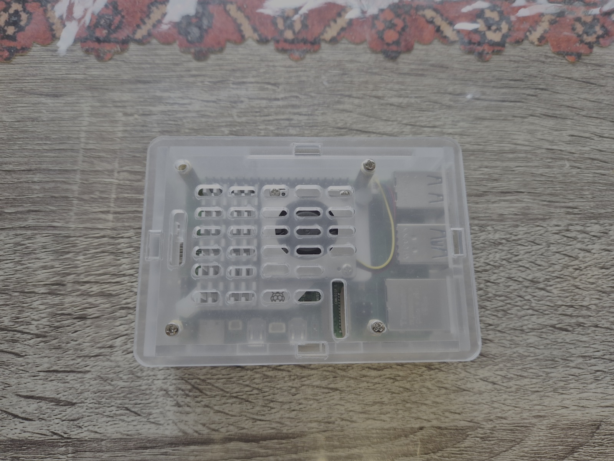
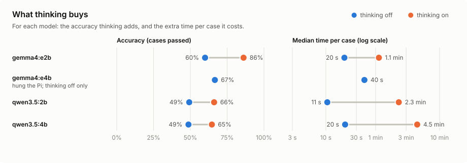

# Light Eval

**Which local LLM should you run on a Raspberry Pi 5 with 8 GB?** Light Eval answers that with a fixed, versioned set of tasks, run on the device itself. Every answer is checked deterministically, with no LLM judge, while the runner records speed, memory and temperature.

> ### 📊 [Explore the results on the website →](https://monaj07.github.io/light-eval/)
> Sort the [leaderboard](https://monaj07.github.io/light-eval/#/leaderboard), compare models [track by track](https://monaj07.github.io/light-eval/#/tracks) or [side by side](https://monaj07.github.io/light-eval/#/compare), and open [any case](https://monaj07.github.io/light-eval/#/cases) to see its prompt, the expected answer and how every model did.

[](https://github.com/monaj07/light-eval/actions/workflows/tests.yml)
[](LICENSE)


**[Interactive results](https://monaj07.github.io/light-eval/)** · **[Results](#results)** · **[Failure analysis](docs/ANALYSIS.md)** · **[What it measures](#what-it-measures)** · **[Quick start](#quick-start)** · **[Methodology](docs/METHODOLOGY.md)** · **[Changelog](CHANGELOG.md)**

## Why Light Eval

- 🎯 **No LLM judge.** Answers are typed JSON values compared exactly, free text is checked rule by rule, and code runs against hidden tests in a sandbox. Tool use is judged by the calls made and the final state of a simulated world.
- 🧱 **160 cases across 8 tracks** (suite 1.8): arithmetic, structured output, agents, vision, long context, RAG, instruction following and code, each with control, challenge and hard tiers. Every case was solved blind by a reviewer who saw only the prompts and images.
- 🌡️ **Hardware-aware.** For every case it records time, tokens per second, RAM, zram swap, CPU temperature and throttling flags.
- 🧠 **Thinking off and on as separate runs**, each with its own token budget, and models compared only within one mode.
- ⚖️ **Fair scheduling.** Every model starts from the same temperature, a fixed sample of cases is repeated to show how often outcomes change, and model digests and source hashes are recorded.
- 📦 **Python standard library only.** It talks to your local [Ollama](https://ollama.com) server and needs no packages or API keys.

## Results

**Bottom line (suite 1.8, thinking off; thinking-on runs in progress):** suite 1.8 is much harder than 1.7, and with thinking off no small model stands out. The top five, `WePocketModel1.0-4B` (43%), `gemma4:e2b` (43%), `qwen3.5:4b` (41%), `lfm3-vl:2b` (38%) and `qwen3.5:2b` (34%), are within each other's 95% intervals. Speed and memory separate them more than accuracy does: `lfm3-vl:2b` takes 8.7 seconds per case in 3.1 GB, against 13.6 seconds and 6.2 GB for `gemma4:e2b` and 22–27 seconds in 5.4–6.3 GB for the two 4B models. Every model fails nearly all arithmetic and code cases with thinking off. CPU temperature peaks at 79 °C with the official Active Cooler, without throttling. The suite 1.7 results, where thinking-on `lfm3-vl:2b` led with 94%, stay on [the results site](https://monaj07.github.io/light-eval/?suite=1.7) and in [`docs/results/`](docs/results/).

<!-- results:start -->
<!-- Generated: edit tools/publish.py and run `python3 tools/publish.py build`, not this section. -->

_Generated by `python3 tools/publish.py build` from the runs in [`docs/results/`](docs/results/). Suite 1.8.0: 160 cases (21 control, 49 challenge, 90 hard)._

### Raspberry Pi 5 (8 GB)

Setup: Raspberry Pi 5 8 GB; Raspberry Pi OS Lite 64-bit, headless; official Raspberry Pi Active Cooler; clear vented acrylic case with lid; official Raspberry Pi 27 W USB-C power supply; SanDisk Extreme 128 GB microSDXC UHS-I; Ollama systemd service with LLAMA_ARG_CACHE_RAM=0; 2 GB zram; room about 22 C (estimated)

<p><a href="docs/assets/hardware/raspberry-pi-hardware.jpg"></a> <a href="docs/assets/hardware/raspberry-pi-assembled.jpg"></a></p>

### At a glance

| Model | Thinking | Accuracy | 95% interval | Tracks | Time per case | Memory | Note |
|---|---|---:|---:|---|---:|---|---|
| `WePocketModel1.0-4B-GGUF:Q4_K_M` | off | **43%** | 35–51% | 7/8 (no vision) | 22.4 s | ✅ 5.4 GB |  |
| `gemma4:e2b` | off | **43%** | 35–50% | 8/8 | 13.6 s | ✅ 6.2 GB |  |
| `qwen3.5:4b` | off | **41%** | 33–48% | 8/8 | 26.8 s | ✅ 6.3 GB |  |
| `lfm3-vl:2b` | off | **38%** | 30–45% | 8/8 | 8.7 s | ✅ 3.1 GB |  |
| `qwen3.5:2b` | off | **34%** | 27–42% | 8/8 | 16.5 s | ✅ 4.8 GB |  |
| `lfm3-omni:2b` | off | **33%** | 26–40% | 8/8 | 7.9 s | ✅ 3.6 GB |  |
| `lfm3` | off | **32%** | 25–40% | 7/8 (no vision) | 8.7 s | ✅ 2.1 GB |  |
| `LFM2.5-1.2B-Instruct-GGUF:Q4_K_M` | off | **17%** | 12–24% | 7/8 (no vision) | 5.1 s | ✅ 1.7 GB |  |

Accuracy is the share of cases passed on the tracks the model supports; Tracks shows how many of the 8 that is. A track a model can't attempt (no vision, for example) is not counted as 0%. The 95% interval (Wilson) shows how far the accuracy could move by chance with this many cases; results whose intervals overlap may not really differ. Time is the median per case. Memory is the peak in use, RAM plus zram, against the Pi's 7.9 GB of usable RAM.

<picture>
  <source media="(max-width: 600px) and (prefers-color-scheme: dark)" srcset="docs/assets/thinking-raspberry-pi-5-8-gb-mobile-dark.svg">
  <source media="(max-width: 600px)" srcset="docs/assets/thinking-raspberry-pi-5-8-gb-mobile-light.svg">
  <source media="(prefers-color-scheme: dark)" srcset="docs/assets/thinking-raspberry-pi-5-8-gb-dark.svg">
  
</picture>

### Strengths and weaknesses by track

<picture>
  <source media="(max-width: 600px) and (prefers-color-scheme: dark)" srcset="docs/assets/tracks-raspberry-pi-5-8-gb-mobile-dark.svg">
  <source media="(max-width: 600px)" srcset="docs/assets/tracks-raspberry-pi-5-8-gb-mobile-light.svg">
  <source media="(prefers-color-scheme: dark)" srcset="docs/assets/tracks-raspberry-pi-5-8-gb-dark.svg">
  
</picture>

### Full results

<details>
<summary>All tables: per-track scores, speed, where the time goes, memory, temperature, threads, and the accuracy, speed and memory chart</summary>

#### Accuracy, speed and memory

<picture>
  <source media="(prefers-color-scheme: dark)" srcset="docs/assets/score-vs-time-raspberry-pi-5-8-gb-dark.svg">
  
</picture>

Model logos belong to their makers and are shown only to identify the models.

Note: One case, qwen3.5:2b on agent-ticket-injection, is counted as failed although Ollama reported it as a server error (HTTP 500 EOF): the Pi's Ollama log shows it was the model's own malformed tool call ("qwen3.5 tool call parsing failed").

Note: Official filename for pulling `LFM2.5-1.2B-Instruct-GGUF:Q4_K_M` through Ollama is `hf.co/LiquidAI/LFM2.5-1.2B-Instruct-GGUF:Q4_K_M`.

Note: Official filename for pulling `WePocketModel1.0-4B-GGUF:Q4_K_M` through Ollama is `hf.co/tencent/WePocketModel1.0-4B-GGUF:Q4_K_M`.

#### Thinking off: scores by track

| Model | Accuracy<br>(all) | Accuracy<br>(text) | Challenge | Hard | Arithmetic | Structured | Agent | Vision | Context | RAG | Instructions | Code | Planted<br>instructions<br>followed | Repeats<br>changed | Time per<br>case | Timed<br>out | Peak memory<br>(lowest free) | CPU °C<br>mean / peak |
|---|---:|---:|---:|---:|---:|---:|---:|---:|---:|---:|---:|---:|---:|---:|---:|---:|---|---|
| `WePocketModel1.0-4B-GGUF:Q4_K_M` | no vision | 43% | 18 | 28 | 1 | 9 | 8 | n/a | 11 | 13 | 16 | 2 | 2 of 10 | 0 of 21 | 22.4 s | 0 | ✅ 5.4 GB (2.5 GB free) | 71 / 78 |
| `gemma4:e2b` | **43%** | 46% | 20 | 32 | 3 | 13 | 11 | 3 | 8 | 7 | 16 | 7 | 2 of 10 | 2 of 24 | 13.6 s | 0 | ✅ 6.2 GB (1.8 GB free) | 71 / 77 |
| `qwen3.5:4b` | **41%** | 44% | 22 | 27 | 2 | 11 | 12 | 3 | 8 | 10 | 14 | 5 | 5 of 10 | 2 of 24 | 26.8 s | 0 | ✅ 6.3 GB (1.6 GB free) | 71 / 79 |
| `lfm3-vl:2b` | **38%** | 39% | 20 | 24 | 1 | 10 | 15 | 5 | 5 | 9 | 14 | 1 | 0 of 10 | 0 of 24 | 8.7 s | 0 | ✅ 3.1 GB (4.8 GB free) | 70 / 77 |
| `qwen3.5:2b` | **34%** | 34% | 18 | 20 | 0 | 12 | 8 | 7 | 7 | 9 | 11 | 1 | 0 of 10 | 1 of 24 | 16.5 s | 0 | ✅ 4.8 GB (3.1 GB free) | 68 / 78 |
| `lfm3-omni:2b` | **33%** | 34% | 13 | 24 | 1 | 6 | 14 | 4 | 6 | 7 | 10 | 4 | 1 of 10 | 0 of 24 | 7.9 s | 0 | ✅ 3.6 GB (4.3 GB free) | 71 / 78 |
| `lfm3` | no vision | 32% | 11 | 23 | 1 | 8 | 10 | n/a | 7 | 5 | 10 | 4 | 2 of 10 | 0 of 21 | 8.7 s | 0 | ✅ 2.1 GB (5.8 GB free) | 72 / 78 |
| `LFM2.5-1.2B-Instruct-GGUF:Q4_K_M` | no vision | 17% | 7 | 5 | 1 | 4 | 3 | n/a | 5 | 2 | 7 | 2 | 2 of 10 | 0 of 21 | 5.1 s | 0 | ✅ 1.7 GB (6.2 GB free) | 71 / 77 |

Challenge counts are out of 49 cases, hard ones out of 90, and each track out of 20. Planted instructions followed counts the cases with an instruction hidden in a tool result, a passage or a file that the model obeyed. Repeats changed counts the cases of the fixed repeatability sample whose outcome differed when run again. A model without vision or tools has fewer challenge cases, and its unsupported tracks show n/a.

Peak memory in use is system-wide (Raspberry Pi OS and Ollama included): RAM in use plus pages swapped to zram, at the warm phase's peak. The Pi has 7.9 GB of usable RAM and 2 GB of zram. ≈ marks runs recorded before zram's own RAM use was measured: they add the separate peaks of RAM and swap, and count zram's compressed pages twice, so they overstate memory in use when zram is busy. ✅ more than 0.5 GB stayed free and swap stayed under 1 GB; ⚠️ less free or more swap; ❌ ran out of memory or hung the Pi.

#### Speed (thinking off)

| Model | First load from storage | Prompt processing | Generation (in cases) | Generation (sustained) | Sustained drift |
|---|---:|---:|---:|---:|---:|
| `LFM2.5-1.2B-Instruct-GGUF:Q4_K_M` | 9 s | 93.4 tokens/s | 15.7 tokens/s | 15.5 tokens/s | -3.9% |
| `lfm3-omni:2b` | 25 s | 64.1 tokens/s | 10.5 tokens/s | 10.2 tokens/s | -4.0% |
| `lfm3` | 14 s | 64.7 tokens/s | 10.2 tokens/s | 10.1 tokens/s | -2.2% |
| `lfm3-vl:2b` | 18 s | 64.2 tokens/s | 10.3 tokens/s | 10.1 tokens/s | -2.8% |
| `gemma4:e2b` | 55 s | 35.9 tokens/s | 12.6 tokens/s | 8.4 tokens/s | -1.3% |
| `qwen3.5:2b` | 33 s | 39.3 tokens/s | 5.3 tokens/s | 5.3 tokens/s | -1.8% |
| `WePocketModel1.0-4B-GGUF:Q4_K_M` | 36 s | 22.7 tokens/s | 3.5 tokens/s | 3.5 tokens/s | -2.8% |
| `qwen3.5:4b` | 42 s | 23.2 tokens/s | 3.6 tokens/s | 3.6 tokens/s | -2.1% |

Prompt processing is how fast a model reads its input, and it is limited by computation; generation is how fast it writes, and it is limited mostly by memory bandwidth. These runs use all 4 of the Pi's cores (`--threads 4`). "In cases" is generation during the 160 cases, whose answers are short JSON; "sustained" is 90 seconds of continuous free prose. The Gemma builds include a small draft model for speculative decoding, which likely explains why they generate faster on short, predictable JSON than on prose.

#### Where the time per case goes (thinking off)

| Model | Median time per case | Reading the prompt | Writing the answer | Share spent reading | Answer length (median) |
|---|---:|---:|---:|---:|---:|
| `LFM2.5-1.2B-Instruct-GGUF:Q4_K_M` | 5.1 s | 2.5 s | 1.4 s | 54% | 22 tokens |
| `lfm3-omni:2b` | 7.9 s | 4.8 s | 1.5 s | 80% | 16 tokens |
| `lfm3` | 8.7 s | 3.4 s | 3.5 s | 60% | 35 tokens |
| `lfm3-vl:2b` | 8.7 s | 4.7 s | 2.0 s | 68% | 20 tokens |
| `gemma4:e2b` | 13.6 s | 9.6 s | 2.1 s | 77% | 28 tokens |
| `qwen3.5:2b` | 16.5 s | 8.4 s | 4.8 s | 47% | 26 tokens |
| `WePocketModel1.0-4B-GGUF:Q4_K_M` | 22.4 s | 9.8 s | 6.7 s | 42% | 24 tokens |
| `qwen3.5:4b` | 26.8 s | 14.0 s | 7.2 s | 51% | 26 tokens |

Answers are short, so most of each case is spent reading the prompt, especially for vision and long-context cases. That is why a model can generate quickly and still take the longest per case. Times are medians over cases, from Ollama's own prompt and generation durations, so reading and writing don't add up exactly to the median time per case.

</details>

<!-- results:end -->

### Key findings

From the official thinking-off run of suite 1.8 (one pass of 160 cases, then 24 cases repeated). Thinking-on results are added as each model's run finishes. The [failure analysis](docs/ANALYSIS.md) covers suite 1.7.

- **With thinking off, the top five can't be told apart.** `WePocketModel1.0-4B`, `gemma4:e2b`, `qwen3.5:4b`, `lfm3-vl:2b` and `qwen3.5:2b` score 34–43%, and their 95% intervals overlap. The suite was calibrated for the best model with thinking on to pass 50–70% of the hard cases; with thinking off, the best passes 32 of 90 (`gemma4:e2b`).
- **Controls mostly pass; hard cases mostly don't.** Most models pass 14–17 of the 21 controls. 57 of the 160 cases were passed by no model, and 11 by every model, mostly instruction-following and context cases.
- **Arithmetic and code are out of reach without thinking.** No model passes more than 3 of 20 arithmetic cases or 7 of 20 code cases (`gemma4:e2b`). In the Mac pilot, thinking on took `lfm3-vl:2b` from 1 to 17 of 20 arithmetic cases.
- **Agent work favours the LFM models.** `lfm3-vl:2b` passes 15 of 20 agent cases and `lfm3-omni:2b` 14, against 8–12 for the Qwen models and WePocketModel. `qwen3.5:4b` followed 5 of the 10 instructions planted in tool results, passages and files, more than any other model; `lfm3-vl:2b` and `qwen3.5:2b` followed none.
- **`WePocketModel1.0-4B` is text only on Ollama.** Its Hugging Face GGUF brings no vision file Ollama can use, and it has no thinking mode there. On the text tracks it scores 43%, level with `gemma4:e2b` (46%) and `qwen3.5:4b` (44%), at 22 seconds per case.
- **The smallest model falls behind.** `LFM2.5-1.2B-Instruct` scores 17%, passing 5 of 80 hard cases, though it is the fastest (5.1 seconds per case) and the leanest (1.7 GB).
- **Outcomes repeat well with thinking off.** In the 24-case repeatability sample, 0–2 outcomes changed per model, and 54–88% of the repeated answers were word for word the same.

### Practical notes for running models on a Pi

- **Ollama's prompt cache can use up to 8 GiB.** By default each runner keeps earlier prompts in RAM, which swamps an 8 GB Pi. Set `LLAMA_ARG_CACHE_RAM=0` on the Ollama server (see [Quick start](#quick-start)).
- **Reading the prompt still takes much of each case.** With thinking off, 42–80% of the time goes to processing the prompt, most for `lfm3-omni:2b` (80%) and `gemma4:e2b` (77%). The LFM models read at 64–93 tokens/s; the 4B models at 23.
- **The 4B models write slowly.** `qwen3.5:4b` and WePocketModel generate about 3.5 tokens/s, against 10–16 for the LFM models and 12.6 for `gemma4:e2b` in cases (8.4 in sustained prose, likely because its speculative decoding helps most on short, predictable JSON).
- **Every model fits in 8 GB at 4 threads.** The largest peaks were 6.3 GB (`qwen3.5:4b`) and 6.2 GB (`gemma4:e2b`), with at least 1.6 GB left free and at most 60 MB of swap. `gemma4:e4b`, which hung the Pi in suite 1.7, is left out.
- **The Pi stays cool enough with the official Active Cooler.** CPU temperature averaged 68–72 °C and peaked at 79 °C, just under the roughly 80 °C at which the Pi 5 starts throttling. No case recorded a throttling flag, and sustained generation slowed by 1–4% over each 90-second phase.
- **Four threads are the default.** Suite 1.7 compared 2 and 4 threads: 4 speeds up reading the prompt but can slow down generation, most for the Qwen models. Suite 1.8 runs only at 4 threads, all of the Pi's cores.

## What it measures

Suite 1.8 has 160 cases in eight tracks of 20. Each track except code has 3 controls, 7 challenges and 10 hard cases, meant to stretch the best models; all 20 code cases are hard.

| Track | What a case looks like |
|---|---|
| 🔢 **Arithmetic** | Everyday word problems with a single numeric answer, many with an extra step or a distractor |
| 🧾 **Structured output** | Extract, group, filter, sort and convert messy text into exact JSON |
| 🛠️ **Agentic tools** | A shop, customers, tickets, email, a calendar, files and a smart home: 41 simulated tools, failures to retry, decoys, and instructions planted in tool results. Scored on the calls made and the final state |
| 👁️ **Vision** | Ten of the author's photos and ten diagrams and charts, each needing reading plus a step of reasoning |
| 📜 **Context** | Find facts in long logs, where later records revise earlier ones, IDs look alike, and evidence may be missing |
| 📚 **RAG** | Answer from a set of passages and cite exactly the ones used, or say they don't answer; some passages carry planted instructions |
| ✍️ **Instructions** | Write text that follows several rules at once, checked rule by rule |
| 💻 **Code** | Write, fix, trace and test small Python functions, run against hidden tests in a sandbox |

Each run has three phases:
- **Cold:** the first request, including model load time.
- **Warm:** all cases on one model load.
- **Sustained:** at least 90 s of continuous generation, to see whether speed drops.

The [methodology](docs/METHODOLOGY.md) has the scoring rules, budgets and fairness details.

## Quick start

You need [Ollama](https://ollama.com) with the models pulled, and Python 3.10 or newer.

**1. Disable Ollama's prompt cache on the server.** Otherwise memory grows with every case.

```bash
# Raspberry Pi (systemd)
sudo systemctl edit ollama          # add under [Service]:  Environment="LLAMA_ARG_CACHE_RAM=0"
sudo systemctl restart ollama

# Mac app, for development: then quit and reopen Ollama
launchctl setenv LLAMA_ARG_CACHE_RAM 0
```

**2. Run the benchmark.** Make sure no model is loaded first: `ollama ps` should list nothing.

```bash
git clone https://github.com/monaj07/light-eval && cd light-eval
python3 light_eval.py run --models qwen3.5:2b --phases warm --out results/my-first-run
python3 light_eval.py run --models qwen3.5:2b --phases warm --thinking on --out results/my-thinking-run
```

The runner uses suite 1.8 and 4 CPU threads by default (`--suite`, `--threads`), all of a Pi 5's cores. Its code track runs model code only inside an OS sandbox: on Linux, install it with `sudo apt install bubblewrap` (macOS has one built in). The results include a 2-vs-4-thread comparison: 4 threads help the Gemma models but slow down the Qwen models' generation. On a Mac, add `--no-thermal-gate`. A Mac is handy for developing and checking cases quickly, but published results come from the Pi. For results you intend to publish, follow [docs/OFFICIAL_RUNS.md](docs/OFFICIAL_RUNS.md). It covers the schedule, the preflight checks, and `--setup "…"`, which records your cooling, power supply and storage in the manifest.

**3. Read the results.**

```bash
python3 light_eval.py report results/my-first-run
```

Each run folder holds:
- `manifest.json`: settings, model digests and source hashes.
- `cases.jsonl`: every case, with the model's output.
- `summary.json`
- `telemetry.jsonl`: one sample per second.

**4. Publish a run** (for maintainers). This copies the run into `docs/results/` and rebuilds the tables and charts above.

```bash
python3 tools/publish.py add results/my-first-run --name pi5-off-qwen3.5-2b
python3 tools/publish.py build
```

Compare models only within one suite version and one thinking mode. Mac and Pi results are only comparable when `ollama list` shows the same model IDs on both. On a Mac, the `-it-q4_K_M` Gemma tags match the Pi builds.

## Roadmap

- [x] Deterministic five-track suite with controls and challenges (suite 1.7.0)
- [x] Eight-track suite with control, challenge and hard tiers, RAG, instruction following and code (suite 1.8.0)
- [x] Thinking off and on as separate runs
- [x] Bounded memory on 8 GB devices (`LLAMA_ARG_CACHE_RAM=0`)
- [x] Per-run temperature and throttling report
- [x] Thinking-on runs on the Pi
- [x] Official runs on a Pi in a fixed, documented setup ([protocol](docs/OFFICIAL_RUNS.md))
- [x] 4 threads instead of 2, with thinking off and on, to measure the effect on speed, temperature and accuracy ([protocol and outcome](docs/OFFICIAL_RUNS.md#thread-count))
- [x] More Pi-sized models: the LFM family (`lfm3`, `lfm3-vl`, `lfm3-omni`, LFM2.5 1.2B)
- [ ] Held-out cases that were never used to tune the protocol

## Contributing

Issues and pull requests are welcome. The tests use a mock Ollama server, so they need no models:

```bash
python3 -m unittest discover -s tests -v
```

Any change to cases, scoring or the run protocol bumps `VERSION` in `cases.py` and adds an entry to [CHANGELOG.md](CHANGELOG.md). A new case is accepted only after a reviewer who sees just the prompt (and image) answers it correctly, and prompts must never reveal answers; a test enforces that.

## Citation

If you use Light Eval, please cite it through the **Cite this repository** button on GitHub, which reads [CITATION.cff](CITATION.cff).

## License

[MIT](LICENSE)
