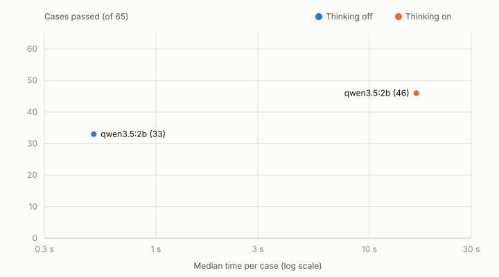

# Light Eval

**Which local LLM should you run on a Raspberry Pi 5 with 8 GB?** Light Eval answers that with a fixed, versioned set of tasks, run on the device itself. Every answer is checked deterministically, with no LLM judge, while the runner records speed, memory and temperature.

[](https://github.com/monaj07/light-eval/actions/workflows/tests.yml)
[](LICENSE)


**[Results](#results)** · **[What it measures](#what-it-measures)** · **[Quick start](#quick-start)** · **[Methodology](docs/METHODOLOGY.md)** · **[Changelog](CHANGELOG.md)**

## Why Light Eval

- 🎯 **No LLM judge.** Answers are typed JSON values compared exactly. Tool calls are checked call by call, including arguments, order and final state.
- 🧱 **65 cases across 5 tracks**, each with controls and harder challenges. Every case was solved blind by a reviewer who saw only the prompts and images.
- 🌡️ **Hardware-aware.** For every case it records time, tokens per second, RAM, zram swap, CPU temperature and throttling flags.
- 🧠 **Thinking off and on as separate runs**, each with its own token budget, and models compared only within one mode.
- ⚖️ **Fair scheduling.** Model order is balanced across cycles, every model starts from the same temperature, and model digests and source hashes are recorded.
- 📦 **Python standard library only.** It talks to your local [Ollama](https://ollama.com) server and needs no packages or API keys.

## Results

<!-- results:start -->

_Generated by `python3 tools/publish.py build` from the runs in [`docs/results/`](docs/results/). Suite 1.7.0: 65 cases (29 control, 36 challenge)._

### Raspberry Pi 5 (8 GB)

† Exploratory run: one pass, no recorded hardware setup. [Official runs](docs/OFFICIAL_RUNS.md) will replace these rows.

**Thinking off**

| Model | Score /65 | Challenge /36 | Arithmetic /13 | Structured /13 | Agent /13 | Vision /13 | Context /13 | Median time per case | Timed out | Memory (lowest free) | CPU °C (mean / peak) |
|---|---:|---:|---:|---:|---:|---:|---:|---:|---:|---|---|
| `gemma4:e4b` † | **44** | 20 | 3 | 12 | 12 | 7 | 10 | 40.3 s | 0 | ⚠️ tight: 26 MB free, 2.0 GB swap | — / 68 |
| `qwen3.5:2b` † | **32** | 15 | 4 | 6 | 11 | 4 | 7 | 10.6 s | 0 | ✅ 3.7 GB free | — / 69 |

<picture>
  <source media="(prefers-color-scheme: dark)" srcset="docs/assets/score-vs-time-raspberry-pi-5-8-gb-dark.svg">
  
</picture>

### Mac, Apple silicon (Metal)

† Exploratory run: one pass, no recorded hardware setup. [Official runs](docs/OFFICIAL_RUNS.md) will replace these rows.

**Thinking off**

| Model | Score /65 | Challenge /36 | Arithmetic /13 | Structured /13 | Agent /13 | Vision /13 | Context /13 | Median time per case | Timed out | Memory (lowest free) | CPU °C (mean / peak) |
|---|---:|---:|---:|---:|---:|---:|---:|---:|---:|---|---|
| `qwen3.5:2b` † | **33** | 15 | 4 | 7 | 11 | 4 | 7 | 0.5 s | 0 | — | — |

**Thinking on**

| Model | Score /65 | Challenge /36 | Arithmetic /13 | Structured /13 | Agent /13 | Vision /13 | Context /13 | Median time per case | Timed out | Memory (lowest free) | CPU °C (mean / peak) |
|---|---:|---:|---:|---:|---:|---:|---:|---:|---:|---|---|
| `qwen3.5:2b` † | **46** | 24 | 11 | 10 | 8 | 7 | 10 | 16.6 s | 0 | — | — |

<picture>
  <source media="(prefers-color-scheme: dark)" srcset="docs/assets/score-vs-time-mac-apple-silicon-metal-dark.svg">
  
</picture>

<!-- results:end -->

### Findings so far

- **Thinking helps a lot, except on agent tasks.** With thinking on, `qwen3.5:2b` goes from 33 to 46 of 65 on the Mac, but its agent score drops from 11 to 8. The thinking models tested tend to add tool calls nobody asked for, and strict trace scoring counts those as failures.
- **The Pi and the Mac agree.** `qwen3.5:2b` with the same model build gave word-for-word identical output on 60 of 65 cases on the Pi (CPU) and the Mac (Metal), and the scores differ by one case.
- **`gemma4:e4b` is the largest model that fits, just.** With thinking off it completes the suite on the Pi, but it fills the 8 GB of RAM and the 2 GB of zram. About 0.2–0.3 GB stayed free for most of the run, and 26 MB at the lowest.
- **Ollama's prompt cache can use up to 8 GiB.** By default each runner keeps earlier prompts in RAM, which swamps an 8 GB Pi. Set `LLAMA_ARG_CACHE_RAM=0` on the Ollama server (see [Quick start](#quick-start)).
- **The Pi stays cool enough with the official Active Cooler.** CPU temperature peaked at 68–69 °C in both Pi runs, below the roughly 80 °C at which the Pi 5 starts throttling. No case recorded a throttling flag, and generation speed stayed steady from the first case to the last.
- **On the Pi, time matters more than tokens with thinking on.** At about 5 tokens/s, a 10-minute case limit allows roughly 3,000 generated tokens, fewer than some cases need.

## What it measures

| Track | What a case looks like | Controls | Challenges |
|---|---|---:|---:|
| 🔢 **Arithmetic** | Multi-step word problems: percentages, time across midnight, compound interest, clock-hand angles | 6 | 7 |
| 🧾 **Structured output** | Extract, group, filter, sort and convert into exact JSON | 6 | 7 |
| 🛠️ **Agentic tools** | Native tool calls against a deterministic order-and-indicator simulator; tool use and the final answer are scored separately | 6 | 7 |
| 👁️ **Vision** | Counting among distractors, relative position, chart ranking, reading a receipt or a table and calculating | 6 | 7 |
| 📜 **Context** | Find facts in 8- to 96-record logs, with revisions, cross-references, filters and missing evidence | 5 | 8 |

Each run has three phases:
- **Cold:** the first request, including model load time.
- **Warm:** all cases on one model load.
- **Sustained:** at least 90 s of continuous generation, to see whether speed drops.

The [methodology](docs/METHODOLOGY.md) has the scoring rules, budgets and fairness details.

## Quick start

You need [Ollama](https://ollama.com) with the models pulled, and Python 3.10 or newer.

**1. Disable Ollama's prompt cache on the server.** Otherwise memory grows with every case.

```bash
# Raspberry Pi (systemd)
sudo systemctl edit ollama          # add under [Service]:  Environment="LLAMA_ARG_CACHE_RAM=0"
sudo systemctl restart ollama

# Mac app: then quit and reopen Ollama
launchctl setenv LLAMA_ARG_CACHE_RAM 0
```

**2. Run the benchmark.** Make sure no model is loaded first: `ollama ps` should list nothing.

```bash
git clone https://github.com/monaj07/light-eval && cd light-eval
python3 light_eval.py run --models qwen3.5:2b --phases warm --out results/my-first-run
python3 light_eval.py run --models qwen3.5:2b --phases warm --thinking on --out results/my-thinking-run
```

On a Mac, add `--no-thermal-gate`. For results you intend to publish, follow [docs/OFFICIAL_RUNS.md](docs/OFFICIAL_RUNS.md). It covers the schedule, the preflight checks, and `--setup "…"`, which records your cooling, power supply and storage in the manifest.

**3. Read the results.**

```bash
python3 light_eval.py report results/my-first-run
```

Each run folder holds:
- `manifest.json`: settings, model digests and source hashes.
- `cases.jsonl`: every case, with the model's output.
- `summary.json`
- `telemetry.jsonl`: one sample per second.

**4. Publish a run** (for maintainers). This copies the run into `docs/results/` and rebuilds the tables and charts above.

```bash
python3 tools/publish.py add results/my-first-run --name pi5-off-qwen3.5-2b
python3 tools/publish.py build
```

Compare models only within one suite version and one thinking mode. Mac and Pi results are only comparable when `ollama list` shows the same model IDs on both. On a Mac, the `-it-q4_K_M` Gemma tags match the Pi builds.

## Roadmap

- [x] Deterministic five-track suite with controls and challenges (suite 1.7.0)
- [x] Thinking off and on as separate runs
- [x] Bounded memory on 8 GB devices (`LLAMA_ARG_CACHE_RAM=0`)
- [x] Per-run temperature and throttling report
- [ ] Thinking-on runs on the Pi
- [ ] Official runs on a Pi in a fixed, documented setup ([protocol](docs/OFFICIAL_RUNS.md))
- [ ] More Pi-sized models: the LFM family (LFM2.5 1.2B and 2.6B, `lfm3-vl`)
- [ ] Held-out cases that were never used to tune the protocol

## Contributing

Issues and pull requests are welcome. The tests use a mock Ollama server, so they need no models:

```bash
python3 -m unittest discover -s tests -v
```

Any change to cases, scoring or the run protocol bumps `VERSION` in `cases.py` and adds an entry to [CHANGELOG.md](CHANGELOG.md). A new case is accepted only after a reviewer who sees just the prompt (and image) answers it correctly, and prompts must never reveal answers; a test enforces that.

## Citation

If you use Light Eval, please cite it through the **Cite this repository** button on GitHub, which reads [CITATION.cff](CITATION.cff).

## License

[MIT](LICENSE)
